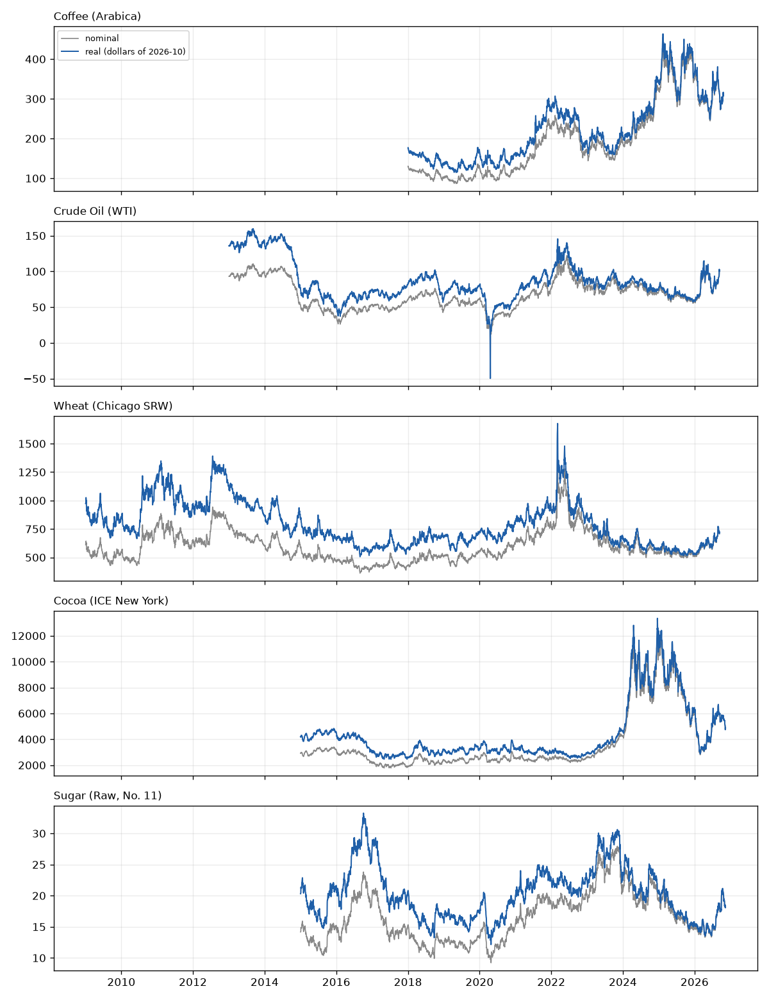

# Inflation comparison

Deflator: US CPI-U, all items, seasonally adjusted (BLS CUSR0000SA0 = FRED CPIAUCSL), 2008-01 to 2026-10. Real prices are in dollars of 2026-10. Months missing from the published series and interpolated: 2025-10.

Produced by `python -m src.analysis.inflation`. The detector itself is unchanged; this is an analysis next to it.

## 1. Whole period: how much of the move is inflation

| Commodity | From | To | Nominal | CPI | Real | Nominal high | Real high | Latest vs real high |
|---|---|---|---|---|---|---|---|---|
| Coffee (Arabica) | 2018-01-02 | 2026-10-23 | +136.1% | +35.9% | +73.8% | 2025-02-13 | 2025-02-13 | -33.7% |
| Crude Oil (WTI) | 2013-01-02 | 2026-09-11 | +7.4% | +45.2% | -26.0% | 2022-03-08 | 2013-09-06 | -37.1% |
| Wheat (Chicago SRW) | 2009-01-02 | 2026-09-11 | +15.7% | +58.7% | -27.1% | 2022-03-07 | 2022-03-07 | -57.7% |
| Cocoa (ICE New York) | 2015-01-02 | 2026-11-12 | +66.8% | +43.4% | +16.4% | 2024-12-18 | 2024-12-18 | -63.4% |
| Sugar (Raw, No. 11) | 2015-01-02 | 2026-11-12 | +27.9% | +43.4% | -10.8% | 2023-11-06 | 2016-10-05 | -45.5% |

Trading days after the last published CPI month (deflated with the last published value): Cocoa (ICE New York) 9, Sugar (Raw, No. 11) 9.

## 2. Year by year: did the commodity beat consumer inflation?

Year-end close vs previous year-end close, against December-to-December CPI. Real = (1 + nominal) / (1 + CPI) - 1.

### Coffee (Arabica) - beat inflation in 5 of 7 years

| Year | Nominal | CPI | Real |
|---|---|---|---|
| 2019 | +27.3% | +2.3% | +24.5% |
| 2020 | -1.1% | +1.3% | -2.4% |
| 2021 | +76.3% | +7.2% | +64.5% |
| 2022 | -26.0% | +6.4% | -30.5% |
| 2023 | +12.6% | +3.3% | +8.9% |
| 2024 | +69.8% | +2.9% | +65.1% |
| 2025 | +9.1% | +2.7% | +6.3% |

### Crude Oil (WTI) - beat inflation in 5 of 12 years

| Year | Nominal | CPI | Real |
|---|---|---|---|
| 2014 | -45.9% | +0.7% | -46.2% |
| 2015 | -30.5% | +0.6% | -30.9% |
| 2016 | +45.0% | +2.1% | +42.1% |
| 2017 | +12.5% | +2.1% | +10.1% |
| 2018 | -24.8% | +2.0% | -26.3% |
| 2019 | +34.5% | +2.3% | +31.4% |
| 2020 | -20.5% | +1.3% | -21.6% |
| 2021 | +55.0% | +7.2% | +44.6% |
| 2022 | +6.7% | +6.4% | +0.3% |
| 2023 | -10.7% | +3.3% | -13.6% |
| 2024 | +0.1% | +2.9% | -2.7% |
| 2025 | -19.9% | +2.7% | -22.0% |

### Wheat (Chicago SRW) - beat inflation in 7 of 16 years

| Year | Nominal | CPI | Real |
|---|---|---|---|
| 2010 | +46.7% | +1.4% | +44.6% |
| 2011 | -17.8% | +3.1% | -20.3% |
| 2012 | +19.2% | +1.8% | +17.1% |
| 2013 | -22.2% | +1.5% | -23.4% |
| 2014 | -2.6% | +0.7% | -3.2% |
| 2015 | -20.3% | +0.6% | -20.8% |
| 2016 | -13.2% | +2.1% | -14.9% |
| 2017 | +4.7% | +2.1% | +2.5% |
| 2018 | +17.9% | +2.0% | +15.5% |
| 2019 | +11.0% | +2.3% | +8.5% |
| 2020 | +14.6% | +1.3% | +13.1% |
| 2021 | +20.3% | +7.2% | +12.3% |
| 2022 | +2.8% | +6.4% | -3.4% |
| 2023 | -20.7% | +3.3% | -23.3% |
| 2024 | -12.2% | +2.9% | -14.6% |
| 2025 | -8.1% | +2.7% | -10.4% |

### Cocoa (ICE New York) - beat inflation in 5 of 10 years

| Year | Nominal | CPI | Real |
|---|---|---|---|
| 2016 | -33.8% | +2.1% | -35.1% |
| 2017 | -11.0% | +2.1% | -12.9% |
| 2018 | +27.7% | +2.0% | +25.2% |
| 2019 | +5.1% | +2.3% | +2.7% |
| 2020 | +2.5% | +1.3% | +1.1% |
| 2021 | -3.2% | +7.2% | -9.7% |
| 2022 | +3.2% | +6.4% | -3.0% |
| 2023 | +61.4% | +3.3% | +56.2% |
| 2024 | +178.2% | +2.9% | +170.5% |
| 2025 | -48.1% | +2.7% | -49.4% |

### Sugar (Raw, No. 11) - beat inflation in 4 of 10 years

| Year | Nominal | CPI | Real |
|---|---|---|---|
| 2016 | +28.0% | +2.1% | +25.4% |
| 2017 | -22.3% | +2.1% | -23.9% |
| 2018 | -20.6% | +2.0% | -22.2% |
| 2019 | +11.6% | +2.3% | +9.0% |
| 2020 | +15.4% | +1.3% | +13.9% |
| 2021 | +21.9% | +7.2% | +13.7% |
| 2022 | +6.1% | +6.4% | -0.2% |
| 2023 | +2.7% | +3.3% | -0.6% |
| 2024 | -6.4% | +2.9% | -9.0% |
| 2025 | -22.1% | +2.7% | -24.1% |

## 3. Does deflating change what the detector flags?

The same detector (75-day window, z >= 2.0, 10-day cumulative check, contract-switch handling where a list exists) run on nominal and on deflated prices.

| Commodity | Days | Flagged (nominal) | Flagged (real) | Days that differ | Median daily move | Median daily CPI drift |
|---|---|---|---|---|---|---|
| Coffee (Arabica) | 2142 | 279 | 278 | 7 | 1.38% | 0.0100% |
| Crude Oil (WTI) | 3368 | 420 | 416 | 6 | 1.27% | 0.0087% |
| Wheat (Chicago SRW) | 4373 | 519 | 513 | 16 | 1.18% | 0.0085% |
| Cocoa (ICE New York) | 2908 | 361 | 360 | 3 | 1.21% | 0.0092% |
| Sugar (Raw, No. 11) | 2909 | 377 | 376 | 7 | 1.11% | 0.0092% |

Dates that differ: Coffee (Arabica): 2019-12-12, 2021-04-27, 2022-04-13, 2022-06-02, 2022-08-24, 2023-10-18, 2026-06-26; Crude Oil (WTI): 2014-02-07, 2014-02-18, 2018-11-09, 2021-06-04, 2021-12-06, 2024-08-26; Wheat (Chicago SRW): 2013-08-27, 2014-04-21, 2016-03-10, 2018-05-04, 2019-03-21, 2020-03-24, 2020-07-09, 2021-07-21, 2022-12-06, 2024-02-20, 2024-04-24, 2025-01-13, 2025-03-06, 2026-02-20, 2026-02-24, 2026-02-25; Cocoa (ICE New York): 2018-02-26, 2019-04-05, 2025-10-13; Sugar (Raw, No. 11): 2022-03-04, 2022-05-09, 2022-07-18, 2022-07-19, 2022-07-27, 2023-12-04, 2024-09-04

Largest distance of a differing day's z-score from the 2.0 cut-off: Coffee (Arabica) 0.056; Crude Oil (WTI) 0.011; Wheat (Chicago SRW) 0.061; Cocoa (ICE New York) 0.009; Sugar (Raw, No. 11) 0.046. Days that differ are days the detector was already on the fence about.

Reading this table: the CPI moves prices by about a hundredth of a percent a day, against typical daily moves of one to two percent, so a daily z-score is almost blind to it. Inflation matters for statements about price LEVELS (a record high, a multi-year comparison), which is what sections 1 and 2 are for; it is not a reason to change the detector.

